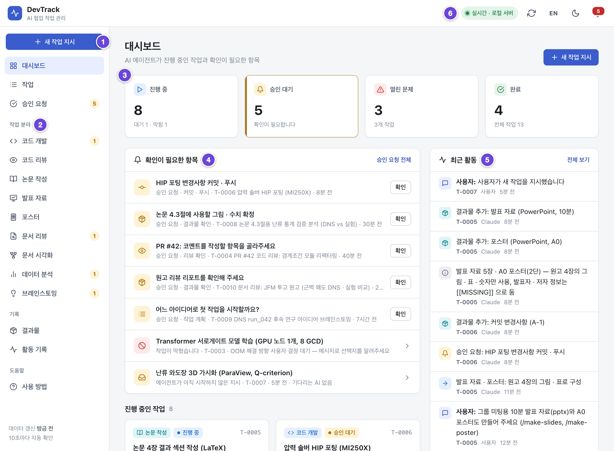

# DevTrack — AI 협업 작업 관리

[English](README.md) · **한국어**

Claude · Codex 등 AI 에이전트가 수행하는 작업(코드 개발, 코드 리뷰, 논문/LaTeX, 문서 리뷰, 데이터 분석, 시각화, AI 모델 개발, 브레인스토밍)의
**진행 상황 · 문제점 · 결과물**을 웹에서 확인하고, **승인이 필요한 항목을 알림으로 받아 승인/수정 요청**하는 서비스입니다.
승인된 코드 변경은 에이전트가 대상 저장소에 commit · push 합니다.



1. **새 작업 지시** — 웹에서 AI 에게 일을 맡깁니다 (채팅으로 지시해도 됩니다).
2. **작업 분야** — 작업을 종류별로 모아 봅니다: 코드 개발, 코드 리뷰, 논문 작성, 문서 리뷰, 데이터 분석, 브레인스토밍.
3. **한눈에 보기** — 진행 중 · 승인 대기 · 열린 문제 · 완료된 작업 수.
4. **확인이 필요한 항목** — AI 가 확인을 구한 것: 커밋 · 푸시, 결과물 확인, 게시할 리뷰 코멘트 고르기, 아이디어 고르기.
   **확인** 을 누르면 diff 나 리포트를 보고 승인 / 수정 요청 / 거절합니다.
5. **최근 활동** — AI 가 남긴 기록, 최신순.
6. **위쪽 막대** — `실시간 · 로컬 서버` 이면 웹에서 누른 것이 바로 저장됩니다. 그 옆은 새로고침, **EN**(영어 화면), 다크 모드, 승인 대기 수가 붙은 종 아이콘입니다.

<sub>[빠른 시작](#빠른-시작-로컬에서-예시-화면-보기)의 예시 데이터로 본 화면입니다.</sub>

```text
 사용자 ── 작업 지시 ──▶ AI 에이전트 (Claude, Codex)
   ▲                         │ devtrack CLI 로 기록
   │                         ▼   (단계 · 문제 · 결과물 · 승인 요청)
   │                 data/  (작업별 JSON + 결과물 파일)
   │                         │
   └── 웹 대시보드 ◀─────────┘   알림 → 승인 / 수정 요청 / 거절
            │
            └─ 승인 ─▶ 에이전트가 devtrack apply ─▶ git commit + push
```

> 처음이라면 → **[사용 방법 (단계별 매뉴얼)](web/guide.md)** — 웹 대시보드 왼쪽 아래 `사용 방법` 메뉴에서도 볼 수 있습니다.
> 웹은 처음 열면 영어 화면입니다. 오른쪽 위 `한` 단추를 누르면 한국어로 바뀌고, 고른 언어는 브라우저에 기억됩니다.
> 영어판 사용 방법: [web/guide.en.md](web/guide.en.md) (영어 화면의 `Guide` 메뉴).

## 작업끼리 이어 가기

실제 일은 작업 하나로 끝나지 않는 경우가 많아서, DevTrack 은 작업을 서로 연결하기 쉽게 되어 있습니다. 새 작업을 만들 때
(**새 작업 지시** 의 **관련 작업** 칸에서 여러 개를 고르거나 번호를 직접 적어서, 또는 `devtrack new … --related T-ID …`) 연결하거나, 나중에 `devtrack link T-0008 T-0005` 로 연결합니다.
연결된 작업은 서로의 화면에 함께 보여서, 사용자와 AI 가 흐름을 따라가고 앞 작업의 결과를 이어 쓸 수 있습니다.
에이전트 규칙에 따라 AI 도 논문에 쓸 분석처럼 이어지는 작업을 만들 때 스스로 연결합니다.

예시 데이터의 흐름:

- **데이터 분석 → 논문:** 분석 작업 `T-0008` 이 논문 작업 `T-0005` 에 연결되어 있습니다. 논문 작성 화면의 **연결된 데이터 분석** 에 나타나고,
  원고의 LaTeX 미리보기는 그 분석의 그림을 파일 이름으로 찾아 보여 줍니다. **이 논문용 분석 지시** 를 누르면 다음 분석이 처음부터 연결된 채로 만들어집니다.
- **분석 → 브레인스토밍 → 새 작업:** `T-0009` 는 그 분석을 바탕으로 후속 연구 아이디어(I1, I2…)를 정리합니다. 이어갈 아이디어를 체크하고
  **이 아이디어로 작업 지시** 를 누르면 브레인스토밍에 연결된 새 작업이 생깁니다.
- **논문 → 문서 리뷰:** `T-0010` 은 투고 전에 원고를 리뷰하는 작업으로, 논문 작업에 연결되어 있어 리뷰와 원고 작성을 나란히 볼 수 있습니다.

## 작업마다 맞는 모델로

작업마다 처리할 AI 모델과 추론 강도를 정할 수 있습니다. 예를 들어 어려운 포팅은 **Opus 5.5 · Extra high**, 간단한 정리는 **Sonnet 5.5** 로 정합니다.
**새 작업 지시** 의 **모델** · **추론 강도** 칸이나 `devtrack new … --model claude-opus-5-5 --effort xhigh` 로 정하고,
나중에 작업 화면이나 `devtrack model T-0006 sonnet-5.5` 로 바꿉니다.
목록에는 Claude 모델과 이 컴퓨터의 Codex 가 받아 둔 Codex 모델이 나오고, 추론 강도는 그 모델이 받는 값만 나옵니다
(`devtrack model --list` 로 확인). 목록에 없는 모델은 이름을 직접 적습니다.

- **실행기는 그대로 지킵니다:** `devtrack watch --claude` (또는 `--codex`) 는 작업을 실행할 때마다 그 작업에 정한 모델 · 강도로 AI 를 띄웁니다.
  같은 작업에 온 다음 메시지 · 결정은 같은 대화로 이어 갑니다 (Claude · Codex 모두).
- **대기 모드 대화는 자기 것이 아닌 작업을 건너뜁니다:** 켜 둔 대화는 자기 모델을 바꿀 수 없으므로, 다른 모델 · 강도로 정한 작업은 받지 않고,
  작업 화면에 그 이유와 할 일을 보여 줍니다. 데모의 `T-0006` 은 Opus 5.5 · Extra high 로 정해져 있습니다.

## AI 끼리 리뷰

코드 작업은 개발이 끝나면 다른 AI 에게 리뷰받도록 정할 수 있습니다. Claude 가 개발하고 Codex 가 리뷰하거나, 그 반대로도 됩니다.
**새 작업 지시** 의 **리뷰 받기** 에서 리뷰어를 고릅니다 (또는 `devtrack new … --review-by Codex --review-rounds 3`).

1. 개발이 끝나면 개발한 AI 가 `devtrack review-request` 를 실행합니다. DevTrack 이 바뀐 코드의 diff 로 리뷰 작업을 만들어 리뷰어에게 맡깁니다.
2. 리뷰어는 검토 항목 R1, R2… 와 판정을 `devtrack review-done` 으로 남기고, 결과는 개발한 AI 에게 `[AI 메시지]` 로 갑니다.
3. 수정이 필요하면 고친 뒤 다시 요청합니다. 두 번째부터는 지난 리뷰 이후 바뀐 부분의 diff 도 함께 가고, 리뷰어는 같은 대화로 이어 가며 앞의 지적을 확인합니다.
4. 통과하면 개발한 AI 가 커밋 승인을 요청합니다. **커밋은 지금처럼 사용자가 승인해야만 됩니다.** 정한 횟수를 다 쓰면 AI 가 사용자에게 결정을 요청합니다.

몇 가지 규칙이 지켜집니다. 리뷰받기로 한 작업은 리뷰를 통과하기 전이나, 통과한 뒤 코드가 다시 바뀌면 커밋 승인을 요청할 수 없습니다.
같은 AI · 같은 모델끼리도 리뷰할 수 있습니다. 리뷰는 늘 개발한 대화와 다른 새 대화가 합니다 (`devtrack watch --claude` 하나가 작업마다 다른 대화로 실행).
**diff 에는 바뀐 코드만 들어갑니다.** CMake 빌드 폴더, `CMakeFiles/`, 오브젝트 · 라이브러리 · 실행 파일은
`.gitignore` 에 없어도 리뷰 diff 와 커밋에서 빠지고, 뺀 것은 따로 표시됩니다.
두 AI 를 모두 켜 두면(`devtrack watch --claude` 와 `devtrack watch --codex`) 반복이 저절로 이어집니다.
데모의 `T-0006`(Claude)은 `T-0012` 에서 Codex 의 2차 리뷰를 통과했습니다.

**논문은 같은 방식으로 저널 심사를 받습니다.** 논문 작업에서는 리뷰어가 투고할 저널의 심사위원으로서 심사합니다
(`--review-doc paper/main.tex --review-venue "J. Fluid Mech."`). 판정은 게재 가능 · 소폭 수정 · 대폭 수정 · 게재 불가입니다.
차례마다 원고(`\input` 파일 · `.bib` · 원고가 부르는 그림을 포함한 LaTeX · Word · PDF · Markdown)가 가고, 2차부터는 지난 심사 이후 바뀐 부분과 저자의 답변서도 함께 갑니다.
답변서는 열린 항목마다 ID 로 나눠(`## R1 — …`) 답해야 하고, 빠진 항목이 있으면 요청이 거절됩니다. DevTrack 은 심사위원의 질문 · 요청과
저자의 답을 차례별로 모아 논문 작업에 **심사 · 답변 기록**을 만들고, 저자는 결과를 알릴 때 이 기록을 첨부합니다.
데모의 `T-0005` 는 `T-0013` 에서 대폭 수정 → 소폭 수정으로 진행 중입니다.

논문 작업마다 기록 안에 **원고 폴더** `tasks/<작업 번호>/paper/` 도 생깁니다. 최신 `.tex` · `.bib` 가 원래 이름으로, 원고가 부르는 그림이
같은 이름의 그림 결과물에서 `figures/` 로 모입니다. 그대로 컴파일하거나 Overleaf 에 올릴 수 있고, 기록을 다른 컴퓨터로 옮기면 함께 따라갑니다.
빠진 그림은 `devtrack paper <작업 번호>` 로 확인합니다.

## 구성

| 구성 요소 | 설명 |
|---|---|
| `bin/devtrack` | 에이전트용 CLI. Python 3.7+ 표준 라이브러리만 사용 (설치 불필요) |
| `web/` | 대시보드. 빌드 없는 정적 HTML/JS — 그대로 정적 호스팅 가능 |
| `devtrack serve` | 로컬 웹 서버. 웹에서 바로 승인 · 피드백 · 작업 지시 저장 |
| `devtrack publish` | 웹 + 데이터를 정적 디렉토리(예: 웹 서버의 공개 폴더)로 배포 |
| `devtrack password` | 웹에 비밀번호 걸기. 비밀번호를 넣은 브라우저만 기록을 읽음 (Apache `.htaccess` 와 `devtrack serve` 가 막음) |
| `devtrack mailbox` | GitHub 비공개 저장소의 이슈를 우편함으로: 정적 웹에서 이슈로 보낸 지시 · 메시지 · 승인을 기다리던 `watch` · 대기 모드가 받아 기록. 그 저장소에 올린 파일의 링크는 작업의 보낸 파일로 함께 받음 |
| `devtrack config` | 기록 폴더 · 웹 공개 폴더 확인 · 설정. `devtrack config data <폴더>` 로 정하면 어느 터미널 · 프로그램에서 실행하든 같은 곳에 기록 |
| `devtrack pptx` | 설명 JSON 으로 편집 가능한 PowerPoint(발표 자료 · 포스터)를 표준 라이브러리만으로 만들고 글자 넘침 점검 · 미리보기 PDF/PNG — `/make-slides` · `/make-poster` 가 씀 |
| `devtrack doc` · `devtrack svgcheck` | 작업이 다루는 문서 파일 경로 · SVG 도식 점검(실행 코드, 넘치거나 겹친 글자) + PNG 미리보기 — `/visualize-doc` 이 씀 |
| `docs/AGENT_PROTOCOL.md` | 에이전트가 따를 기록 규칙 + CLAUDE.md 에 넣을 문구 |
| `templates/review_report.md` · `templates/doc_review_report.md` | 코드 리뷰 · 문서 리뷰 리포트 양식 (일반 사용자도 읽기 쉬운 구성) |
| `integrations/claude-skills/` | DevTrack 에 기록하는 Claude Code 스킬 (`/review-pr`, `/review-doc`, `/visualize-doc`, `/write-paper`, `/make-slides`, `/make-poster`) |

## 빠른 시작 (로컬에서 예시 화면 보기)

```bash
bin/devtrack --data demo-data demo        # 예시 작업 13개 생성 (실제 git 저장소 포함)
bin/devtrack --data demo-data serve --open
# → http://localhost:8765
```

예시에는 승인 대기 중인 커밋 요청(실제 diff), PR 리뷰 리포트(md/pdf), 막힌 학습 작업, 논문 LaTeX 초안,
분석 노트북, 문서 리뷰, AI 끼리 코드 리뷰(`T-0006` → `T-0012`), 논문 심사(`T-0005` → `T-0013`) 등이 들어 있습니다. 웹에서 `T-0006` 커밋 요청을 승인한 뒤 아래를 실행하면 실제 커밋이 만들어집니다.

```bash
bin/devtrack --data demo-data inbox             # 승인 결정 확인
bin/devtrack --data demo-data apply T-0006 A-1  # 커밋 (데모 저장소는 원격이 없어 push 생략)
```

어디서든 쓰려면 PATH 에 연결하세요: `ln -s "$PWD/bin/devtrack" ~/bin/devtrack`

## 웹 화면

- **대시보드** — 진행 중 / 승인 대기 / 열린 문제 / 완료 요약, 확인이 필요한 항목, 진행 중인 작업 카드, 최근 활동
- **작업 상세** — 지시 내용, 현재 단계와 진행률, 작업 계획 체크리스트, 진행 기록 타임라인, 문제점, 결과물, 승인 요청.
  오른쪽 위에서 **완료로 처리**(끝나지 않았어도 완료로 넘김, 메모 가능) · **작업 취소** · **삭제**.
  담당 AI 옆에 작업에 정한 모델 · 추론 강도 (눌러서 변경).
  리뷰 · 심사를 정한 작업은 **AI 리뷰** · **AI 심사** 칸: 차례마다 판정, 열린 항목, 리뷰한 변경 (논문은 답변서와 심사 · 답변 기록도).
  아직 시작하지 않은 작업은 담당 AI 가 지금 웹 지시를 기다리는지(대기 모드 · `devtrack watch`)와, 아니면 깨우는 방법을 표시 (로컬 서버 모드)
- **승인 요청** — 커밋 diff · 리포트를 펼쳐 보고 **승인 / 수정 요청 / 거절** + 코멘트
- **코드 개발** — 코드 개발 작업(유형 `code`)별 카드(대상 저장소 · 브랜치, 지금 하는 일), 반영된 커밋(승인 후 커밋 · 푸시 기록, GitHub 링크), 코드 · diff 결과물. `승인 대기` 필터는 확인이 필요한 작업만 표시
- **코드 리뷰** — **리뷰 결과 한눈에 보기**(PR 정보, 리뷰 의견, 쉬운 요약, 중요도별 남은 항목, 검토 항목 R1, R2… 와 쉬운 설명 · GitHub 위치 링크),
  리뷰 리포트(Markdown · PDF) 뷰어, **PR 코멘트를 작성할 항목을 체크해서 진행**, 코멘트 초안 게시 승인, 의견 보내기.
  Claude Code `/review-pr` 스킬 연동은 [integrations/claude-skills](integrations/claude-skills/README.md)
- **논문 작성** — 논문(유형 `paper`)별 카드: 원고 구성(작성 계획), **컴파일된 PDF**(최신 빌드 · 경고 · 실패 알림), 원고 파일, 그림, 연결된 데이터 분석, 열린 문제. 논문 결과물(PDF · 원고 · 그림 · 표/데이터) 모아보기.
  스킬: `/write-paper` 는 근거 장부에 맞춰 원고를 쓰고 고치며(근거 없는 것은 `[[MISSING]]`), `/make-slides` · `/make-poster` 는 논문의 그림 · 숫자로 편집 가능한 PowerPoint 발표 자료 · 포스터(A0 …)를 `devtrack pptx` 로 만듦 — 외부 서비스 · 이미지 생성 AI 없음
- **LaTeX 문서 보기** — `.tex` 결과물을 코드 대신 읽기 쉬운 문서로 표시: 절 제목 · 수식(KaTeX) · 표 · 목록 · 각주, `\cite`/`\ref`/`\eqref` 번호 연결, `\includegraphics` 는 같은 이름으로 올라온 그림(같은 작업 또는 연결된 분석 작업)을 찾아 표시. `원본 코드` 로 전환 가능. 번호·레이아웃은 실제 PDF 와 다를 수 있는 미리보기
- **문서 리뷰** — 논문 · 보고서 · 제안서(PDF · Word · LaTeX) 리뷰 작업(유형 `docreview`) 목록과, 고른 작업의 **리뷰 결과 한눈에 보기**(리뷰 의견 · 한 줄 결론, 문서 요약, 영역별 평가, 잘된 점, 보완 · 수정할 부분 R1… 의 위치와 **원문 → 수정 제안**), 리뷰 리포트(PDF) · 원본 문서 보기. Word 원본은 글자 · 표를 뽑아 미리보기(표준 라이브러리만). 새 작업 지시에서 문서 경로 · 종류 · 목적 입력.
  논문 · 문서 리뷰 작업의 메시지 칸에서 **시각화 요청** 을 보내면 `/visualize-doc` 스킬이 짜임새 있는 요약과 Claude 가 SVG 로 직접 그린 도식 1–3개를 올림 (문서가 외부 이미지 서비스로 나가지 않음) — 작업 화면의 **시각화** 칸에 표시
- **데이터 분석** — 데이터 분석 · 시각화 작업(유형 `analysis`, `visualization`)과 그림 갤러리, 데이터 · 노트북 · 리포트. `논문용` 필터는 논문 작업에 연결된 분석만 표시
- **브레인스토밍** — 브레인스토밍 작업(유형 `brainstorm`) 목록과, 고른 작업의 주제 · 진행 계획, AI 가 정리한 아이디어 노트, **이어갈 아이디어를 체크해서 고르기**(`request --choices "I1=…"`), 지금까지 고른 아이디어, 의견 보내기, 고른 아이디어로 새 작업 지시(연결된 작업으로 표시)
- **결과물** — Markdown, PDF, 이미지/SVG, diff, 코드/LaTeX(하이라이트), CSV 표, Jupyter 노트북, HTML.
  결과물 화면과 작업의 결과물 탭은 오른쪽 위 단추로 **카드 · 목록** 보기를 바꿀 수 있습니다 (목록은 제목을 줄이지 않고 세로로 나열).
  순서는 **최신순**(마지막으로 올리거나 새 버전이 된 것이 위, 기본)과 **작업별**(작업마다 묶고 작업 안에서는 만든 순서)로 바꿀 수 있습니다.
  결과물을 열면 맨 아래에 **결과물 수정 요청 · 추가 지시** 칸: 그 결과물에 대한 메시지로 AI 에게 가고, AI 는 고친 것을 새 버전으로 올리며, 지금까지의 요청과 버전이 칸 위에 쌓임
- **활동 기록** — 모든 작업의 기록을 날짜별로
- **새 작업 지시** — 제목 · 유형 · 담당 AI · 모델과 추론 강도 · 저장소 · 리뷰어 AI(코드 · 논문 작업) · 관련 작업 · 지시 내용으로 작업 등록
- **사용 방법** — 처음 쓰는 사람이 차례로 따라 하는 매뉴얼 (설치 → Claude 설정 → 작업 지시 → 승인 → 분야별 사용법 → HPC). 원문: [web/guide.md](web/guide.md), 영어판 [web/guide.en.md](web/guide.en.md)
- **알림** — 상단 종 아이콘(승인 대기 수), 새 승인 요청/문제/완료 시 토스트, 선택 시 데스크톱 알림. 10초마다 자동 갱신
- **화면 언어** — 처음 열면 영어 화면입니다. 상단의 `한` / `EN` 단추로 메뉴 · 머리말 · 버튼 · 상태 라벨 같은 화면 틀을 영어 ↔ 한국어로 전환.
  사용 방법 문서도 한국어판(`web/guide.md`) / 영어판(`web/guide.en.md`)으로 바뀝니다. 작업 내용(지시, 진행 기록, 결과물, 리뷰 리포트)은 한국어 그대로이고, 선택은 브라우저에 기억됩니다

### 두 가지 동작 모드

| | 로컬 서버 모드 (`devtrack serve`) | 정적 모드 (웹 공개 폴더) |
|---|---|---|
| 진행 상황 · 알림 보기 | ✅ 자동 갱신 | ✅ 자동 갱신 |
| 승인 · 피드백 · 작업 지시 | 웹에서 바로 저장 | Claude 세션에 붙여넣을 **메시지/명령이 생성됨** — 또는 **GitHub 이슈로 보내면** DevTrack 이 받아 처리 (`devtrack mailbox`, [사용 방법 10-8](web/guide.md#10-8-정적-웹에서-github-이슈로-지시-보내기-우편함)) |

화면 우측 상단의 표시(`실시간 · 로컬 서버` / `정적 · 읽기 전용`)로 현재 모드를 알 수 있습니다.

> ⚠️ 공개 폴더에 올라간 내용(코드 diff, 리포트, 로그)은 URL 을 아는 누구나 볼 수 있습니다.
> `devtrack password` 로 비밀번호를 거세요. 브라우저마다 한 번 묻고, 비밀번호 없이는 웹 서버(Apache `.htaccess`)가 데이터를 내주지 않습니다.
> `.htaccess` 를 읽지 않는 서버에서는 데이터가 아직 공개되어 있다고 화면에 경고가 나옵니다 ([사용 방법 10-7](web/guide.md#10-7-정적-웹에-비밀번호-걸기-권장)).

HPC 같은 원격 서버에서 쓰는 방법(정적 웹, SSH 터널, tmux 로 Claude 띄워 두기)은 [사용 방법 10단계](web/guide.md#10-hpc-에서-쓰기)에 있습니다.

## 에이전트 쪽 사용법

자세한 규칙은 [docs/AGENT_PROTOCOL.md](docs/AGENT_PROTOCOL.md). 핵심 명령:

```bash
TID=$(devtrack new "작업 제목" -t code --repo ~/project --plan "분석" "구현" "테스트")
devtrack step    $TID "지금 하는 일" -p 40
devtrack note    $TID - < notes.md          # 인계 메모: 이 작업에서 알아낸 것 (다른 작업 · 다음 대화가 먼저 읽음)
devtrack check   $TID 1
devtrack issue   $TID "문제 내용" -s high -d "상세"
devtrack artifact $TID result.png -n "결과 그림"
devtrack review  $TID review_report.md
AID=$(devtrack request $TID "변경사항 커밋" --commit -m "커밋 메시지")
devtrack wait    $TID $AID --timeout 1800   # 승인되면 exit 0
devtrack apply   $TID $AID                  # commit + push
devtrack done    $TID -m "완료 요약"
devtrack inbox                              # 웹에서 온 새 지시 · 메시지 · 결정
```

| 명령 | 설명 |
|---|---|
| `new` / `start` / `done` | 작업 생성 / 대기 작업 시작 / 완료 (`--by-user`: 사용자가 끝나지 않은 작업을 완료로 넘긴 것을 기록 — 웹의 **완료로 처리** 와 같음) |
| `cancel` / `delete` | 작업 취소 (기록 유지, 대기 중인 승인 요청 철회) / 작업 삭제 (되돌릴 수 없음, 작업 ID 를 다시 입력해 확인 — 웹에서도 가능) |
| `step` / `status` / `log` | 현재 단계 / 상태·진행률 변경 / 기록 남기기 |
| `plan` / `check` | 작업 계획 설정 / 단계 완료 표시 |
| `link` | 작업 연결 (예: 데이터 분석 → 논문). `new --related T-ID` 로 생성 시 연결도 가능 |
| `model` | 작업을 처리할 AI 모델 · 추론 강도 보기 / 정하기 (`devtrack model T-0006 opus-5.5 --effort xhigh`, `--clear`, `--list` 고를 수 있는 모델 · 강도). `new --model --effort` 로 생성 시 지정도 가능 |
| `review-request` · `review-done` | AI 끼리 리뷰 반복: `review-request T-ID --reviewer Codex` 로 바뀐 코드(빌드 결과물 제외)를 리뷰 요청, 리뷰어는 `review-done T-ID --verdict approve\|changes` 로 결과를 보냄. 논문은 `--doc` · `--venue` · `--response` 와 판정 `accept\|minor\|major\|reject`. `new --review-by` 로 미리 정하고, `request --commit --skip-review` 는 사용자가 그렇게 하라고 할 때만 |
| `send` | 다른 AI 가 맡은 작업에 메시지 보내기 (그 AI 의 inbox 에 `[AI 메시지]`) |
| `issue` / `resolve` | 문제 기록 / 해결 |
| `artifact` / `review` | 결과물 첨부 (파일, `--url`, `--git-diff`, `--source` = 문서 리뷰의 검토할 원본) / 코드 · 문서 리뷰 리포트 등록 + `--findings` 로 검토 항목(R1, R2…) 기록 (문서 리뷰는 `doc` · `checks` · `strengths` 도), `--pdf` 로 PDF 도 만들어 첨부. 같은 이름으로 다시 올리면 새 버전으로 교체(이전 버전 보관, `artifact --replace` 도 동일) |
| `text` | 문서의 글자 뽑기 — Word(`.docx`) → Markdown (표준 라이브러리), PDF → 글자 (`pdftotext` 가 있을 때). 문서 리뷰에서 AI 가 원본을 읽는 용도 |
| `pdf` | Markdown 문서를 PDF 로 변환 (A4, 한글 글꼴, 웹과 같은 모양 — 헤드리스 Chrome/Chromium 사용, `DEVTRACK_CHROME` 으로 경로 지정) |
| `latex` | LaTeX 컴파일 → 성공하면 PDF 를 빌드로 기록(쪽수, 정의 안 된 인용/참조, overfull 경고), 실패하면 오류 위치와 로그 기록. `--pdf` 로 다른 곳에서 만든 PDF 기록 |
| `paper` | 논문 작업의 원고 폴더(`tasks/<작업 번호>/paper`: 최신 `.tex` · `.bib` 와 원고가 부르는 그림) 다시 만들기, LaTeX 가 찾지 못할 그림(확장자가 다름 · 그림 결과물 없음) 확인. 원고 · 그림 결과물이 바뀔 때마다 저절로도 다시 만든다 |
| `request` / `wait` / `apply` | 승인 요청 (`--commit` 이면 diff 자동 첨부, `--choices` 면 사용자가 웹에서 항목을 체크해 고름) / 결정 대기 / 승인된 커밋 실행 |
| `decide` / `comment` | 사용자 결정(`--select R1 R3`) · 메시지 기록 (`--artifact F-ID` 는 결과물 하나에 대한 메시지, 정적 모드에서 에이전트가 대신 기록) |
| `inbox` | 처리할 사용자 입력 — 내게 배정된 작업만 (`--ack` 로 처리 완료 표시, `--wait` 로 새 입력이 올 때까지 대기 — 에이전트가 백그라운드로 실행해 두면 웹 지시에 바로 반응, `--all-agents` 모든 AI, `--task` 한 작업만, `--any-model` 다른 모델로 정한 작업까지) |
| `hook` | Claude Code · Codex 의 PreToolUse 훅 — 그 세션이 맡은 작업을 사용자가 완료로 처리 · 취소 · 삭제했으면 다음 도구 실행을 막고 멈추게 함. 훅에는 항상 0 으로 끝나는 `bin/devtrack-hook` 을 건다 (설정: 웹의 사용 방법 5-4 · 11단계 ⑤) |
| `watch` | AI 실행기: 웹에서 그 AI 에게 온 입력마다 AI 를 실행해 처리 (`--claude` = `claude -p`, `--codex` = `codex exec`, 또는 `-- 명령`). `--claude` · `--codex` 는 작업마다 정한 모델 · 강도로 실행하고, 같은 작업은 같은 대화로 이어 감 — Codex 처럼 대기 모드가 없는 AI 용, 작업을 정한 모델로 지킬 때 |
| `show` / `list` | 작업 상세 / 목록 |
| `serve` / `publish` / `demo` | 로컬 서버 / 정적 배포 / 예시 데이터 |

공통 옵션: `--data DIR`(기본: `$DEVTRACK_DATA` → `devtrack config data` 로 정한 곳 → `<저장소>/data` 순), `--as NAME`(기록자 · 나의 AI 이름, 기본 `$DEVTRACK_AGENT` 또는 Claude), `--json`.

**여러 AI 함께 쓰기**: 작업마다 담당 AI(Claude · Codex · Gemini · 누구나)가 있고, 각 AI 는 자기에게 배정된 작업만 가져갑니다
(`start` 가 담당을 확인, 다른 AI 의 작업은 `start --take`). Codex 설정은 웹의 사용 방법 11단계와
[AGENT_PROTOCOL.md](docs/AGENT_PROTOCOL.md#agentsmd-에-넣을-내용-codex)를 보세요.
작업/항목 ID 는 짧게 써도 됩니다: `devtrack step 3 "..."` = `T-0003`, `resolve 3 1` = `I-1`.

### 커밋 안전장치

- `request --commit` 시점의 변경사항 지문(fingerprint)을 저장하고, `apply` 할 때 다시 계산해 **승인한 diff 와 다르면 실행을 거부**합니다 (`--force` 로 무시 가능).
- 승인되지 않은 요청, 이미 적용된 요청, 승인된 브랜치와 현재 브랜치가 다른 경우에도 실행하지 않습니다.
- 커밋은 성공하고 푸시만 실패하면 그 사실이 기록되고 웹에 오류로 표시됩니다.

## 데이터 구조

```text
data/
  index.json                      대시보드용 요약 (기록할 때마다 재생성)
  tasks/T-0001/task.json          지시, 계획, 기록(log), 문제(issues), 결과물(artifacts), 승인(approvals)
  tasks/T-0001/artifacts/F-1_...  결과물 파일
  tasks/T-0005/paper/             논문 작업의 원고 폴더 (DevTrack 이 다시 만듦 — 직접 고치지 않음)
```

웹은 이 파일들을 읽기만 하므로 정적 호스팅에서도 동작합니다. 쓰기는 CLI 와 로컬 서버만 합니다 (파일 잠금 + 원자적 쓰기).

## 개발

- 프런트엔드: `web/js/app.js`(화면 · 라우팅 · 폴링), `web/js/viewers.js`(결과물 뷰어), `web/js/latex.js`(LaTeX → 문서 미리보기), `web/js/util.js`, `web/js/i18n.js`(화면 틀 영어/한국어), `web/css/app.css`
- 백엔드: `devtrack/store.py`(데이터), `devtrack/cli.py`, `devtrack/server.py`, `devtrack/gitops.py`, `devtrack/demo.py`, `devtrack/latex.py`, `devtrack/pdf.py`(Markdown → PDF), `devtrack/docx.py`(Word → Markdown), `devtrack/models.py`(작업별 모델 · 추론 강도), `devtrack/manuscript.py`(논문 심사용 원고 · 그림 떠 두기)
- 외부 라이브러리는 `web/vendor/` 에 고정 버전으로 포함 (marked 12.0.2, DOMPurify 3.1.6, highlight.js 11.9.0, KaTeX 0.16.11)
- 문서는 짝으로 함께 고친다: `README.md`(영어) / `README.ko.md`(한국어), `web/guide.en.md` / `web/guide.md`
