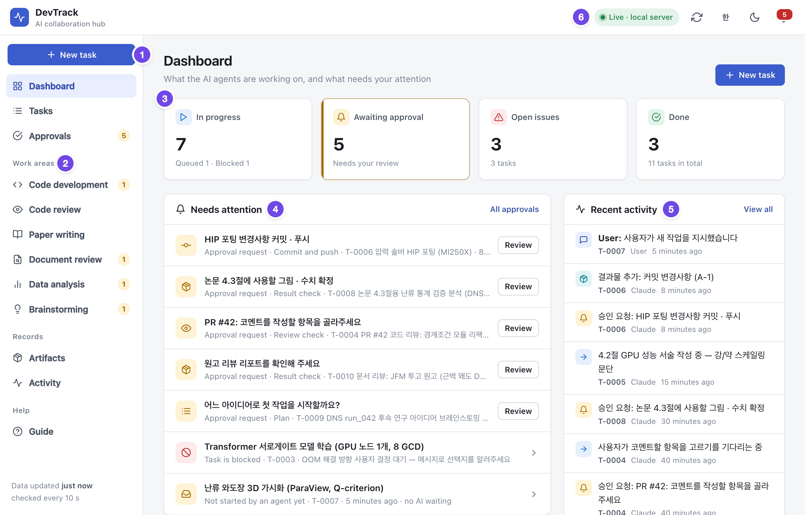

# DevTrack — AI collaboration hub

**English** · [한국어](README.ko.md)

DevTrack is a web dashboard for the work that AI agents such as Claude and Codex do for you: code development, code review,
papers and LaTeX, document review, data analysis, visualization, AI model development and brainstorming.
You see each task's **progress, issues and artifacts**, get **notified when something needs your approval** (approve,
request changes or reject), and can give new instructions from the web. After you approve a code change, the agent commits and
pushes it to the target repository.



1. **New task** — give an AI agent a task from the web (you can also just ask it in the chat).
2. **Work areas** — tasks grouped by kind: code development, code review, paper writing, document review, data analysis, brainstorming.
3. **At a glance** — how many tasks are in progress, waiting for your approval, have open issues, or are done.
4. **Needs attention** — what the agents are asking you: commit and push, check a result, choose which review comments to post, pick an idea.
   **Review** opens the diff or report so you can approve, request changes or reject.
5. **Recent activity** — what the agents recorded, newest first.
6. **Top bar** — `Live · local server` means your clicks on the web are saved directly. Next to it: refresh, **한** (switch to Korean), dark mode, and the bell with the number of pending approvals.

<sub>The demo data from [Quick start](#quick-start-see-the-example-locally). Task titles and records are written by the agents — in Korean here, as the agent rules ask.</sub>

```text
 User ── instruction ──▶ AI agent (Claude, Codex)
   ▲                         │ records with the devtrack CLI
   │                         ▼   (steps · issues · artifacts · approval requests)
   │                 data/  (JSON per task + artifact files)
   │                         │
   └── web dashboard ◀───────┘   notification → approve / request changes / reject
            │
            └─ approved ─▶ agent runs devtrack apply ─▶ git commit + push
```

> New here? → **[DevTrack Guide (step-by-step manual)](web/guide.en.md)** — also under **Guide** at the bottom left of the dashboard.
> The dashboard opens in English. Click **한** at the top right to switch to Korean; the browser remembers your choice.
> The CLI's messages and the agent rules ([docs/AGENT_PROTOCOL.md](docs/AGENT_PROTOCOL.md)) are in Korean, and the rules ask agents
> to write their records and reports in Korean. Korean guide: [web/guide.md](web/guide.md).

## What is in this repository

| Component | Description |
|---|---|
| `bin/devtrack` | CLI for the agents. Python 3.7+ standard library only (nothing to install) |
| `web/` | The dashboard. Static HTML/JS with no build step, so it can be hosted as is |
| `devtrack serve` | Local web server. Approvals, feedback and new tasks from the web are saved directly |
| `devtrack publish` | Publishes the dashboard and the data to a static directory (e.g. a web server's public folder) |
| `docs/AGENT_PROTOCOL.md` | The rules agents follow when recording, and the text to put in CLAUDE.md (Korean) |
| `templates/review_report.md` · `templates/doc_review_report.md` | Report forms for code review and document review, readable by non-specialists |
| `integrations/claude-skills/` | Claude Code skills that record in DevTrack (`/review-pr`, `/review-doc`) |

## Quick start (see the example locally)

```bash
bin/devtrack --data demo-data demo        # create 11 example tasks (including a real git repository)
bin/devtrack --data demo-data serve --open
# → http://localhost:8765
```

The example includes a commit request awaiting approval (with a real diff), a PR review report (md/pdf), a blocked
training task, a LaTeX paper draft, analysis notebooks, document reviews and more. Approve the commit request of `T-0006` on
the web, then run the following to make a real commit:

```bash
bin/devtrack --data demo-data inbox             # see the approval decision
bin/devtrack --data demo-data apply T-0006 A-1  # commit (the demo repository has no remote, so no push)
```

To use it from anywhere, link it into your PATH: `ln -s "$PWD/bin/devtrack" ~/bin/devtrack`

## The dashboard

- **Dashboard** — counts of in progress / awaiting approval / open issues / done, the items that need attention, cards for tasks in progress, recent activity
- **Task details** — instruction, current step and progress, plan checklist, progress log timeline, issues, artifacts, approval requests.
  At the top right: **Mark as done** (moves an unfinished task to done, with an optional note) · **Cancel task** · **Delete**.
  For a task not started yet, it shows whether the assigned AI is waiting for web instructions right now (wait mode · `devtrack watch`) and, if not, how to wake it (local server mode)
- **Approvals** — open the commit diff or the report, then **Approve / Request changes / Reject** with a comment
- **Code development** — a card per code development task (type `code`) with the target repository · branch and what the agent is working on, the commits made (commit · push records after approval, with GitHub links), code · diff artifacts. The `Awaiting approval` filter shows only tasks that need your check
- **Code review** — **Review at a glance** (PR info, verdict, plain-language summary, remaining items by severity, findings R1, R2… with plain explanations and links to the GitHub location),
  a viewer for the review report (Markdown · PDF), **ticking the findings to comment on and proceeding**, approval of the draft comments before they are posted, and feedback on the review.
  The Claude Code `/review-pr` skill: [integrations/claude-skills](integrations/claude-skills/README.md)
- **Paper writing** — a card per paper (type `paper`): manuscript outline (plan), **compiled PDF** (latest build · warnings · failure alerts), manuscript files, figures, linked data analyses, open issues. All paper artifacts (PDF · manuscript · figures · tables/data) in one place
- **LaTeX document view** — shows a `.tex` artifact as a readable document instead of code: section headings · equations (KaTeX) · tables · lists · footnotes, numbered `\cite`/`\ref`/`\eqref` links, and for `\includegraphics` the figure uploaded under the same name (in the same task or a linked analysis task). `Source` switches back to the code. It is a preview: numbering and layout can differ from the real PDF
- **Document review** — review tasks (type `docreview`) for papers, reports and proposals (PDF · Word · LaTeX). For the selected task: **Review at a glance** (verdict · one-line conclusion, document summary, rating per area, strengths, the parts to improve or fix R1… with location and **original → suggested revision**), the review report (PDF) and the original document. Word originals get a preview of their text and tables (standard library only). On New task you enter the document path, kind and purpose
- **Data analysis** — data analysis and visualization tasks (types `analysis`, `visualization`) with a figure gallery, data · notebooks · reports. The `For paper` filter shows only analyses linked to a paper task
- **Brainstorming** — brainstorming tasks (type `brainstorm`). For the selected task: topic and plan, the idea notes the AI wrote, **ticking the ideas to pursue** (`request --choices "I1=…"`), the ideas picked so far, feedback, and a new task from the picked ideas (shown as a linked task)
- **Artifacts** — Markdown, PDF, images/SVG, diff, code/LaTeX (highlighted), CSV tables, Jupyter notebooks, HTML.
  On the Artifacts page and a task's Artifacts tab, the button at the top right switches between **cards** and a **list** (full titles, one per row)
- **Activity** — the records of all tasks, by date
- **New task** — create a task with a title, type, repository and instruction
- **Guide** — a step-by-step manual for first-time users (install → set up Claude → give a task → approve → use by field → HPC). Source: [web/guide.en.md](web/guide.en.md), Korean: [web/guide.md](web/guide.md)
- **Notifications** — the bell at the top (number awaiting approval), pop-ups for new approval requests / issues / completions, and desktop notifications if you turn them on. Refreshes every 10 seconds
- **Display language** — the page opens in English. The `한` / `EN` button at the top switches the page frame (menus, headings, buttons, status labels) between English and Korean,
  and the Guide follows (`web/guide.en.md` / `web/guide.md`). Task content (instructions, progress logs, artifacts, review reports) stays as written. The browser remembers your choice

### Two modes

| | Local server mode (`devtrack serve`) | Static mode (a public web folder) |
|---|---|---|
| Progress · notifications | ✅ refreshes automatically | ✅ refreshes automatically |
| Approvals · feedback · new tasks | saved directly from the web | **a message/command is generated** for you to paste into the Claude session |

The badge at the top right (`Live · local server` / `Static · read-only`) shows the current mode.

> ⚠️ Anything in a published folder (code diffs, reports, logs) can be seen by anyone who knows the URL.
> If it contains sensitive material, use a location where access can be restricted.

Running DevTrack on a remote server such as an HPC system (static web, SSH tunnel, Claude in tmux): [Guide step 10](web/guide.en.md#10-using-devtrack-on-an-hpc-system).

## Using it from the agent

Full rules: [docs/AGENT_PROTOCOL.md](docs/AGENT_PROTOCOL.md) (Korean). Main commands:

```bash
TID=$(devtrack new "Task title" -t code --repo ~/project --plan "Analyze" "Implement" "Test")
devtrack step    $TID "What I am doing now" -p 40
devtrack check   $TID 1
devtrack issue   $TID "Problem" -s high -d "Details"
devtrack artifact $TID result.png -n "Result figure"
devtrack review  $TID review_report.md
AID=$(devtrack request $TID "Commit the changes" --commit -m "Commit message")
devtrack wait    $TID $AID --timeout 1800   # exits 0 when approved
devtrack apply   $TID $AID                  # commit + push
devtrack done    $TID -m "Summary"
devtrack inbox                              # new instructions · messages · decisions from the web
```

| Command | Description |
|---|---|
| `new` / `start` / `done` | Create a task / start a queued task / finish it (`--by-user`: record that the user moved an unfinished task to done, the same as **Mark as done** on the web) |
| `cancel` / `delete` | Cancel a task (records are kept, pending approval requests are withdrawn) / delete a task (cannot be undone; confirm by typing the task ID again — also possible on the web) |
| `step` / `status` / `log` | Current step / change status · progress / add a log entry |
| `plan` / `check` | Set the plan / mark a step done |
| `link` | Link tasks (e.g. data analysis → paper). `new --related T-ID` links them when the task is created |
| `issue` / `resolve` | Record an issue / resolve it |
| `artifact` / `review` | Attach an artifact (file, `--url`, `--git-diff`, `--source` = the original under review in a document review) / register a code or document review report: `--findings` records the findings (R1, R2…) (plus `doc` · `checks` · `strengths` for document reviews), `--pdf` also makes and attaches a PDF. Uploading under the same name replaces it with a new version (earlier versions are kept; `artifact --replace` does the same) |
| `text` | Extract a document's text — Word (`.docx`) → Markdown (standard library), PDF → text (when `pdftotext` is installed). The AI uses it to read the original in a document review |
| `pdf` | Convert a Markdown document to PDF (A4, Korean fonts, the same look as the web; uses headless Chrome/Chromium, path set with `DEVTRACK_CHROME`) |
| `latex` | Compile LaTeX. On success, record the PDF as a build (page count, undefined citations/references, overfull warnings); on failure, record where the error is and the log. `--pdf` records a PDF built elsewhere |
| `request` / `wait` / `apply` | Approval request (`--commit` attaches the diff automatically, `--choices` lets the user tick items on the web) / wait for the decision / run an approved commit |
| `decide` / `comment` | Record a user decision (`--select R1 R3`) · message (in static mode the agent records them for the user) |
| `inbox` | User input to handle, for tasks assigned to me only (`--ack` marks it handled; `--wait` waits until new input arrives, so an agent that runs it in the background reacts to web instructions right away; `--all-agents` for all AIs; `--task` for one task) |
| `hook` | PreToolUse hook for Claude Code · Codex: if the user marked the session's task as done, cancelled or deleted it, the next tool call is blocked so the agent stops. Always hook up `bin/devtrack-hook`, which always exits 0 (setup: Guide 5-4 and step 11 ⑤) |
| `watch` | AI runner: runs the AI for each input sent to it from the web (`--codex` = `codex exec`, or `-- command`), for AIs without a wait mode such as Codex |
| `show` / `list` | Task details / task list |
| `serve` / `publish` / `demo` | Local server / static publish / example data |

Common options: `--data DIR` (default `$DEVTRACK_DATA` or `<repository>/data`), `--as NAME` (who records, i.e. my AI's name; default `$DEVTRACK_AGENT` or Claude), `--json`.

**Several AIs together:** each task has an assigned AI (Claude · Codex · Gemini · anyone), and each AI takes only the tasks assigned to it
(`start` checks the assignment; `start --take` takes another AI's task). For Codex setup, see step 11 of the Guide and
[AGENT_PROTOCOL.md](docs/AGENT_PROTOCOL.md#agentsmd-에-넣을-내용-codex).
Task and item IDs can be shortened: `devtrack step 3 "..."` = `T-0003`, `resolve 3 1` = `I-1`.

### Commit safeguards

- `request --commit` stores a fingerprint of the changes at that moment. `apply` computes it again and **refuses to run if it differs from the approved diff** (`--force` overrides this).
- It also refuses requests that are not approved, that were already applied, or that were approved for a different branch than the current one.
- If the commit succeeds but the push fails, this is recorded and shown as an error on the web.

## Data layout

```text
data/
  index.json                      summary for the dashboard (rebuilt on every write)
  tasks/T-0001/task.json          instruction, plan, log, issues, artifacts, approvals
  tasks/T-0001/artifacts/F-1_...  artifact files
```

The web only reads these files, so it works on static hosting too. Only the CLI and the local server write them (file locks + atomic writes).

## Development

- Frontend: `web/js/app.js` (views · routing · polling), `web/js/viewers.js` (artifact viewers), `web/js/latex.js` (LaTeX → document preview), `web/js/util.js`, `web/js/i18n.js` (English/Korean page frame), `web/css/app.css`
- Backend: `devtrack/store.py` (data), `devtrack/cli.py`, `devtrack/server.py`, `devtrack/gitops.py`, `devtrack/demo.py`, `devtrack/latex.py`, `devtrack/pdf.py` (Markdown → PDF), `devtrack/docx.py` (Word → Markdown)
- External libraries are vendored in `web/vendor/` at fixed versions (marked 12.0.2, DOMPurify 3.1.6, highlight.js 11.9.0, KaTeX 0.16.11)
- Documentation comes in pairs — keep them in step: `README.md` / `README.ko.md` and `web/guide.en.md` / `web/guide.md`
