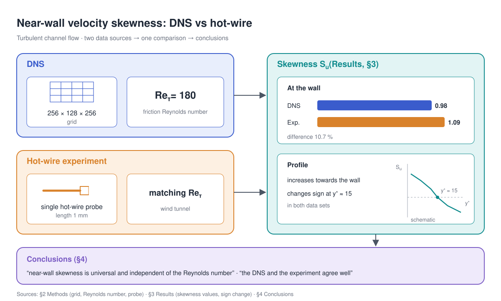
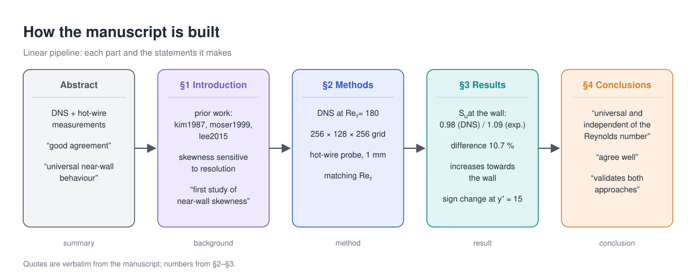

# 시각화 요약: Near-wall velocity skewness in low-Reynolds-number turbulent channel flow

> **한 줄 요약:** 난류 채널 유동의 벽 근처 속도 왜도(Su)를 DNS(Reτ = 180)와 열선 풍속계 실험으로 구해 비교했고, 벽에서 0.98 대 1.09(차이 10.7 %), y⁺ ≈ 15 에서 부호가 바뀌는 점이 두 자료에서 같다고 보고합니다.

| 문서 | 종류 | 분량 | 초점 |
|---|---|---|---|
| H. Kang, J. Lee — JFM 투고 원고 | 과학 논문 (LaTeX) | 4쪽, 약 2,850단어 | 전체 |

## 1. 한눈에 보기

**읽는 법:** 왼쪽 위(DNS)와 왼쪽 아래(열선 실험) 두 자료가 오른쪽의 왜도 비교로 모이고, 그 비교가 아래의 결론으로 이어집니다.
오른쪽 아래 작은 그래프는 "벽 쪽으로 갈수록 커지고 y⁺ ≈ 15 에서 부호가 바뀐다"는 문장을 모양으로 옮긴 것(개략도)이며 실제 측정 곡선이 아닙니다.
**근거:** §2 Methods (격자 · Reτ · 탐침), §3 Results (Su 값 · 부호 변화), §4 Conclusions.

## 2. 문서 지도

| 절 | 역할 | 한 줄 요지 |
|---|---|---|
| Abstract | 요약 | DNS 와 열선 측정이 잘 맞고, 벽 근처 왜도가 보편적(universal)이라고 요약 |
| §1 Introduction | 배경 | 선행 연구(kim1987 · moser1999 · lee2015)를 들고, 고차 통계는 해상도에 민감하다고 설명. "벽 근처 왜도의 첫 연구"라고 주장 |
| §2 Methods | 방법 | DNS: Reτ = 180, 256 × 128 × 256 격자. 실험: 길이 1 mm 단일 열선 탐침, 같은 Reτ |
| §3 Results | 결과 | 벽에서 Su = 0.98(DNS) · 1.09(실험), 차이 10.7 %. 벽 쪽으로 증가, y⁺ ≈ 15 에서 부호 변화 |
| §4 Conclusions | 결론 | 벽 근처 왜도는 보편적이고 레이놀즈 수와 무관. 두 방법이 잘 맞아 서로를 검증 |

## 3. 핵심 주장과 근거

1. **두 방법이 잘 맞는다** — 근거: 벽에서 0.98 대 1.09, 차이 10.7 % (§3). "잘 맞는다"의 기준은 문서에 없습니다.
2. **벽 근처 왜도는 보편적이다** — 근거: 두 자료에서 같은 경향(벽 쪽 증가, y⁺ ≈ 15 부호 변화) (§3).
3. **레이놀즈 수와 무관하다** — 근거로 제시된 자료는 Reτ = 180 하나입니다 (§2). *(정리자 의견: 여러 레이놀즈 수의 비교가 있어야 뒷받침되는 주장입니다.)*
4. **벽 근처 왜도의 첫 연구다** — §1. 같은 절에서 선행 연구 세 편을 인용합니다. *(정리자 의견: 무엇이 처음인지 구체적으로 밝힐 필요가 있습니다.)*

## 4. 방법 흐름

1. DNS 로 Reτ = 180 채널 유동을 256 × 128 × 256 격자에서 계산 (§2)
2. 풍동에서 같은 마찰 레이놀즈 수로 단일 열선 탐침(1 mm) 측정 (§2)
3. 두 자료의 유동 방향 속도 왜도 Su 를 벽 수직 방향(y⁺)으로 비교 (§3)

## 5. 주요 결과

| 결과 | 값 | 조건 | 위치 |
|---|---|---|---|
| 벽에서 왜도 (DNS) | Su = 0.98 | Reτ = 180 | §3 |
| 벽에서 왜도 (실험) | 1.09 | 같은 Reτ | §3 |
| 두 값의 차이 | 10.7 % | — | §3 |
| 부호가 바뀌는 위치 | y⁺ ≈ 15 | 두 자료 모두 | §3 |

## 6. 문서 구조 · 논리 흐름 (V2)

**읽는 법:** 왼쪽에서 오른쪽으로 원고의 다섯 부분과 각 부분이 하는 말입니다. 따옴표는 원문 그대로입니다.
결론(§4)의 "independent of the Reynolds number" 를 방법(§2)의 Reτ = 180 하나와 나란히 보면 주장과 근거의 범위 차이가 드러납니다.
**근거:** 원고 전체 (Abstract, §1–§4).

## 7. 한계 · 열린 질문

- 문서가 직접 밝힌 한계는 없습니다.
- *(정리자 의견)* 레이놀즈 수가 하나뿐이라 "레이놀즈 수와 무관" · "보편적" 주장의 범위가 넓습니다.
- *(정리자 의견)* 열선 탐침 길이(1 mm)가 점성 길이 단위로 얼마인지, 공간 분해능이 벽 근처 왜도에 주는 영향이 다뤄지지 않았습니다 (§1 이 해상도 민감성을 언급).

## 8. 용어 풀이

- **왜도(skewness, Su):** 속도 변동의 분포가 한쪽으로 얼마나 치우쳤는지 나타내는 3차 통계량.
- **DNS(직접 수치 모사):** 난류 모델 없이 유동 방정식을 모든 크기의 소용돌이까지 직접 푸는 계산.
- **열선 풍속계(hot-wire):** 가는 금속선의 냉각 정도로 유속을 재는 측정 장비.
- **Reτ(마찰 레이놀즈 수):** 벽 마찰 속도 기준의 레이놀즈 수. 클수록 난류의 크기 범위가 넓습니다.
- **y⁺:** 벽에서의 거리를 점성 길이로 나눈 값. 작을수록 벽에 가깝습니다.
